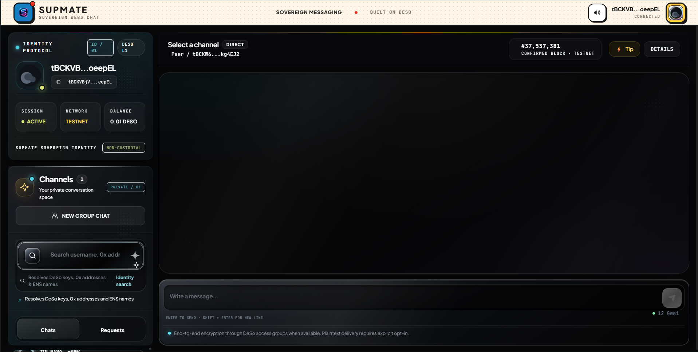
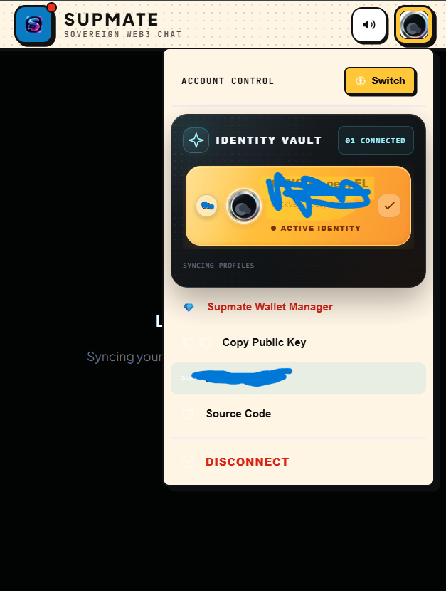
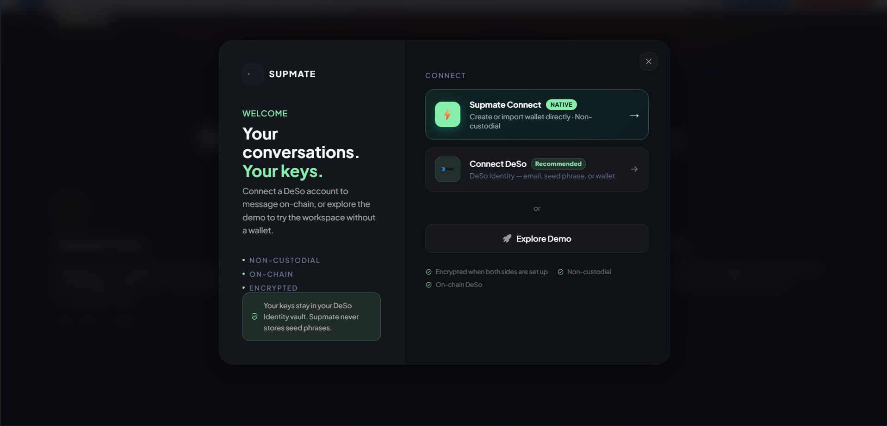
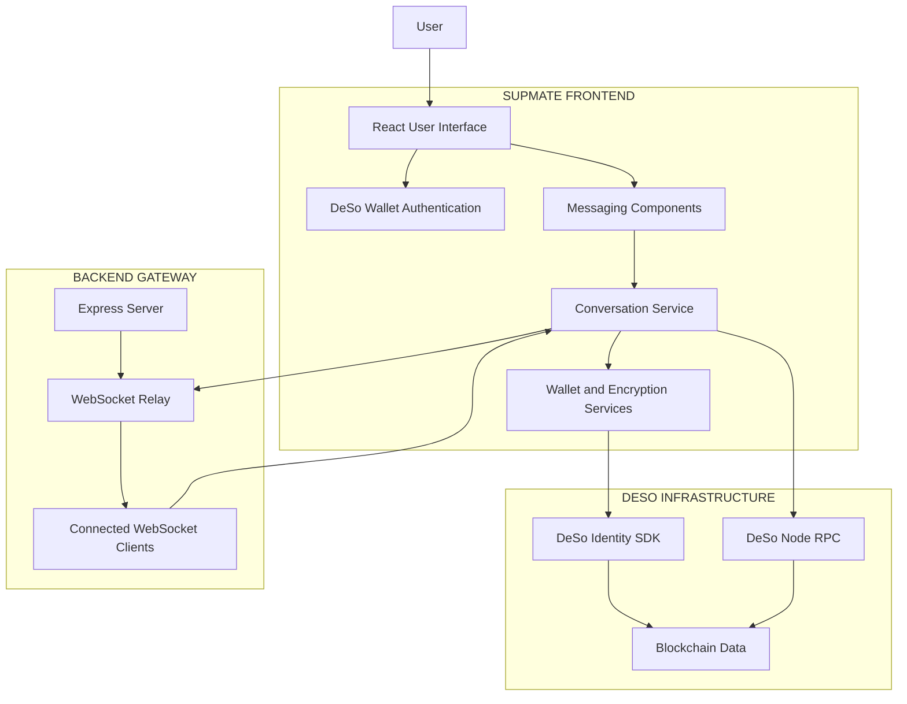
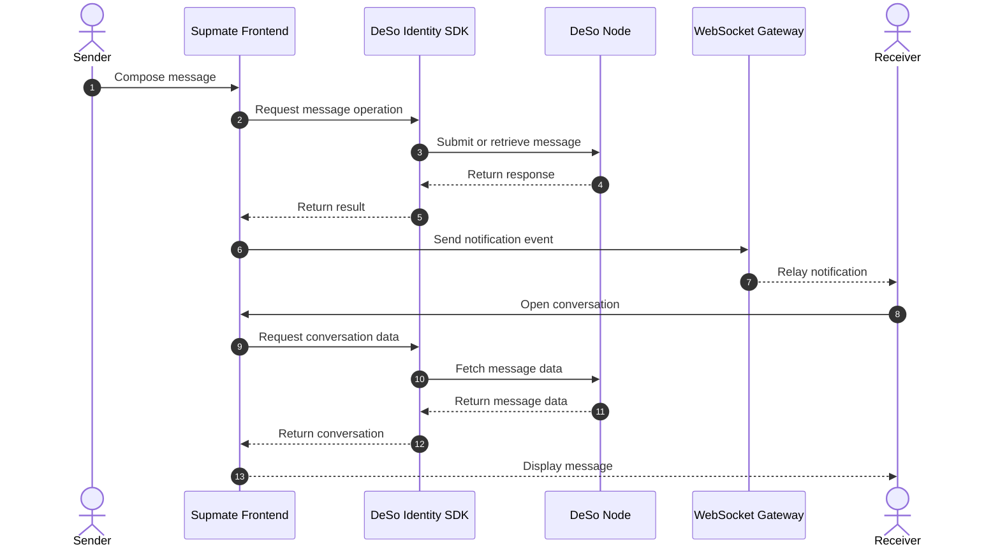
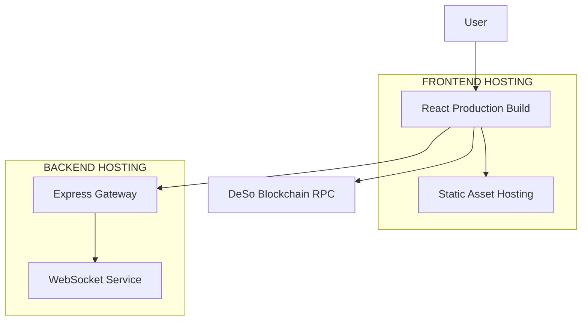

# ⚡ Supmate — Decentralized Web3 Messaging

<div align="center">


### Your Space. Your Keys. Your Conversations.

**A sovereign Web3 messaging experience built on the DeSo blockchain.**

Decentralized Identity · Secure Messaging · Real-Time Communication

[View Repository](https://github.com/GREYHATTER225/supmate-web3)

</div>

---

# 📸 01. Project Demo

Explore the Supmate interface through the screenshots below.

## 🖥️ Application Screenshots

<table>
<tr>
<td width="50%" align="center">

### 💬 Chat Interface



<sub>Main messaging experience</sub>

</td>
<td width="50%" align="center">

### 🏠 Home Screen


<sub>Application landing interface</sub>

</td>
</tr>

<tr>
<td width="50%" align="center">

### 🎬 Demo Screen


<sub>Application demonstration</sub>

</td>
<td width="50%" align="center">

### ℹ️ Information Interface



<sub>Application information interface</sub>

</td>
</tr>

<tr>
<td width="50%" align="center">

### 🔐 Login Interface



<sub>Wallet authentication experience</sub>

</td>
<td width="50%" align="center">

### 📨 Message Sending


<sub>Messaging interface preview</sub>

</td>
</tr>
</table>

---

# 📖 02. About Supmate

Supmate is a portfolio-ready Web3 messaging application demonstrating how decentralized identity and blockchain technology can support modern communication.

Built using React, TypeScript and the DeSo protocol, Supmate combines decentralized wallet authentication, messaging functionality and a real-time communication interface.

## ✨ Core Highlights

- **🔐 Decentralized Authentication** — Users authenticate through DeSo wallet identity.
- **🔒 Message Encryption** — Supports client-side message encryption through the DeSo Identity SDK when messaging access is available.
- **💬 Direct Messaging** — Supports individual conversations.
- **👥 Group Messaging** — Supports group conversations using DeSo access groups.
- **⚡ Real-Time Updates** — A lightweight WebSocket gateway supports message event delivery.
- **🎨 Modern Interface** — Responsive UI with interactive components and animations.
- **🧪 Demo Mode** — Explore supported UI flows using mock demo data without connecting a wallet.

## Project Components

The codebase is divided into two primary parts:

1. **Frontend:** React and TypeScript application.
2. **Backend:** Express and WebSocket gateway.

---

# 🛠️ 03. Feature Overview

| Feature | Description |
|---|---|
| DeSo Authentication | Wallet-based identity and login |
| Direct Messaging | Individual conversations |
| Group Messaging | Group conversations |
| Message Encryption | Client-side encryption through DeSo SDK |
| Unencrypted Fallback | Explicit fallback when encryption is unavailable |
| WebSocket Gateway | Real-time message event relay |
| Demo Mode | Mock conversations and members |
| Conversation Management | Conversation lists and unread tracking |
| Responsive UI | Desktop and mobile layouts |
| Animated Components | Interactive visual components |
| Transaction Confirmation | Transaction-related confirmation handling |

---

# 🏗️ 04. System Architecture

Supmate combines a React frontend, DeSo blockchain integration and a lightweight backend gateway.

## Architecture Diagram



## Architecture Components

### 1. Frontend Layer

The React frontend manages:

- User interface.
- Wallet authentication.
- Conversation management.
- Message composition.
- Message display.
- Wallet and encryption interactions.

### 2. DeSo Infrastructure

The DeSo integration supports:

- Decentralized identity.
- Wallet authentication.
- Access group operations.
- Blockchain-based messaging operations.

### 3. Backend Gateway

The backend uses Express and WebSocket technology.

Its responsibilities include:

- WebSocket connections.
- Message event relay.
- Connected client communication.
- Gateway health and notification routes.

The gateway is separate from the frontend application.

---

# 🔄 05. Message Communication Flow

The following sequence diagram illustrates the intended message lifecycle.



**Note:** This is a conceptual workflow. Exact event ordering and gateway behavior depend on the implemented service logic.

---

# 🌐 06. Deployment Architecture

Supmate can be deployed using separate frontend and backend services.

## Deployment Diagram



## Deployment Options

| Component | Possible Platform |
|---|---|
| Frontend | Vercel, Netlify or static hosting |
| Backend | Railway, Render or VPS |
| Blockchain | DeSo RPC |
| Source Code | GitHub |

These are possible deployment options, not confirmation of an existing deployment.

---

# 🧰 07. Technology Stack

| Category | Technology |
|---|---|
| Frontend | React 18 |
| Programming Language | TypeScript |
| Styling | TailwindCSS |
| Blockchain | DeSo Protocol |
| Wallet Integration | DeSo Identity SDK |
| Backend | Node.js |
| Server Framework | Express |
| Real-Time Communication | WebSocket |
| Testing | Jest |
| Version Control | Git and GitHub |

---

# 🧩 08. Project Structure

```text
Supmate/
│
├── public/
│   ├── assets/
│   │   ├── demo/
│   │   └── demoimages/
│   │       ├── chatui.png
│   │       ├── demoscreen.png
│   │       ├── home.png
│   │       ├── infoui.png
│   │       ├── login.png
│   │       └── text send.png
│   │
│   ├── favicon.png
│   └── index.html
│
├── src/
│   ├── components/
│   │   ├── connect/
│   │   ├── form/
│   │   ├── reactbits/
│   │   ├── shared/
│   │   └── ui/
│   │
│   ├── contexts/
│   ├── hooks/
│   ├── services/
│   ├── utils/
│   │
│   ├── App.tsx
│   └── index.tsx
│
├── server/
│   └── src/
│       ├── routes/
│       ├── services/
│       └── index.ts
│
├── .env.example
├── DEVELOPER_HANDBOOK.md
├── Dockerfile
├── package.json
├── package-lock.json
├── tailwind.config.js
└── README.md
```

---

# ⚙️ 09. Installation & Development

## Prerequisites

| Tool | Minimum Version |
|---|---|
| Node.js | 18+ |
| npm | 9+ |
| Git | Latest stable version |
| DeSo Wallet | Compatible DeSo wallet |

## Step 1. Clone the Repository

```bash
git clone https://github.com/GREYHATTER225/supmate-web3.git

cd supmate-web3
```

## Step 2. Install Dependencies

```bash
npm ci
```

## Step 3. Configure Environment Variables

Create your local environment file:

```bash
cp .env.example .env
```

Configure the required values in `.env`.

Never commit real credentials, API secrets or private keys.

## Step 4. Start the Frontend

```bash
npm start
```

The development server should be available at:

```text
http://localhost:3000
```

---

# ⚙️ 10. Backend Setup

The backend gateway can be started separately.

```bash
cd server

npm ci

npm run dev
```

The example local WebSocket gateway endpoint is:

```text
ws://localhost:5000/ws
```

Configure the frontend gateway URL according to your environment.

---

# 🔐 11. Environment Variables

The following variables are documented for the project.

| Variable | Purpose |
|---|---|
| REACT_APP_GATEWAY_WS_URL | WebSocket gateway endpoint |
| REACT_APP_GATEWAY_HTTP_URL | Optional gateway HTTP endpoint |
| REACT_APP_DESO_RPC_URL | DeSo RPC endpoint |
| REACT_APP_PBKDF2_ITERATIONS | PBKDF2 key derivation setting |
| PORT | Frontend development server port |
| SERVER_PORT | Backend server port |
| SERVER_WS_PATH | WebSocket endpoint path |

## Example Configuration

```env
REACT_APP_GATEWAY_WS_URL=ws://localhost:5000/ws

REACT_APP_GATEWAY_HTTP_URL=http://localhost:5000/api

REACT_APP_DESO_RPC_URL=https://node.deso.org/api/v0

REACT_APP_PBKDF2_ITERATIONS=480000

PORT=3000

SERVER_PORT=5000

SERVER_WS_PATH=/ws
```

**Security warning:** Frontend variables prefixed with `REACT_APP_` are embedded into the frontend bundle. Never place private keys, passwords or secret credentials in them.

---

# 📦 12. Production Build & Deployment

## Build the Frontend

```bash
npm run build
```

The production output is generated in:

```text
build/
```

The resulting static files can be hosted on a compatible static hosting provider.

The WebSocket gateway must be deployed separately if real-time gateway functionality is required.

## Example Deployment: Vercel + Railway

1. Push the repository to GitHub.
2. Connect the repository to Vercel.
3. Configure the frontend environment variables.
4. Deploy the backend gateway separately.
5. Configure the frontend WebSocket URL to point to the deployed gateway.
6. Test wallet authentication and messaging in the deployed environment.

---

# 🔒 13. Security Considerations

Supmate is designed around decentralized identity and client-side messaging operations.

Important considerations:

- Never expose private wallet keys.
- Do not commit `.env` files containing credentials.
- Validate user input before processing.
- Use HTTPS and WSS in production.
- Validate WebSocket connections.
- Handle authentication and authorization carefully.
- Review message encryption and fallback behavior before production use.
- Do not assume that a WebSocket relay itself provides end-to-end encryption.

## Encryption and Fallback

When recipient messaging access is available, the application can use the DeSo SDK's encryption functionality.

If encryption is unavailable, the application provides an explicit fallback flow.

Users should understand whether a message is encrypted before sending it.

---

# 🧪 14. Testing & Project Status

Useful development commands:

```bash
# Run lint
npm run lint

# Run tests
npm test

# TypeScript check
npx tsc --noEmit

# Production build
npm run build
```

## Previously Recorded Project Checks

| Check | Previously Recorded Result |
|---|---|
| Frontend Build | Successful |
| ESLint | 0 errors, 4 warnings |
| TypeScript | Check available |
| Jest | Test runner available |

These are previously recorded results and should be rerun against the current version before claiming fresh verification.

---

# 📈 15. Roadmap

- [ ] Expand automated test coverage.
- [ ] Improve WebSocket reliability.
- [ ] Improve error handling.
- [ ] Expand message interaction features.
- [ ] Improve wallet connection experience.
- [ ] Add more detailed security documentation.
- [ ] Improve mobile experience.
- [ ] Add CI/CD automation.
- [ ] Expand developer documentation.

---

# 🤝 16. Contributing

Contributions are welcome.

## Contribution Steps

1. Fork the repository.
2. Create a feature branch.

```bash
git checkout -b feature/your-feature
```

3. Install dependencies.

```bash
npm ci
```

4. Run available project checks.

```bash
npm run lint
npm test
npm run build
```

5. Commit your changes.

```bash
git add .

git commit -m "Add your feature"
```

6. Push your branch and open a Pull Request.

---

# 📄 17. License

Supmate is released under the MIT License.

See the repository's license file for details.

---

<div align="center">

# ⚡ SUPMATE

### Your Space. Your Keys. Your Conversations.

**Decentralized Identity. Modern Communication. Web3.**

[GitHub Repository](https://github.com/GREYHATTER225/supmate-web3)

</div>
